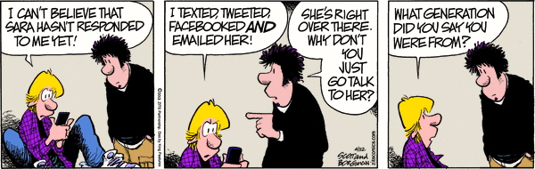
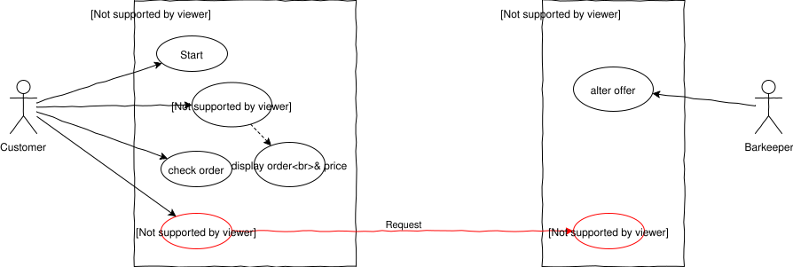
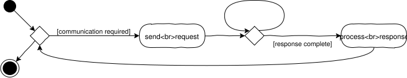
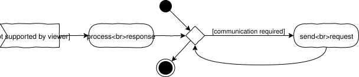
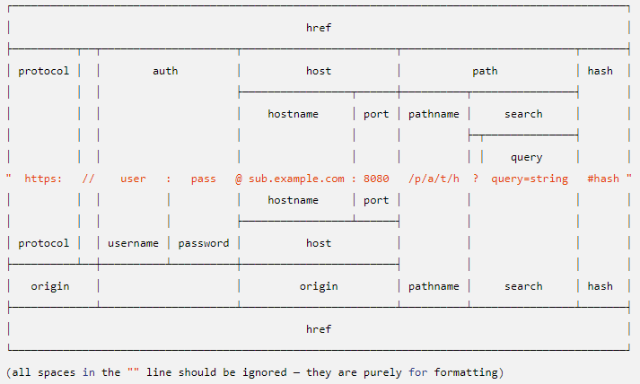
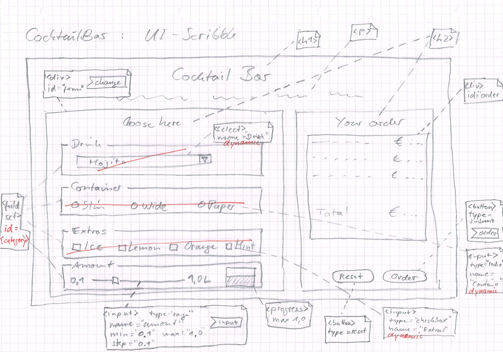
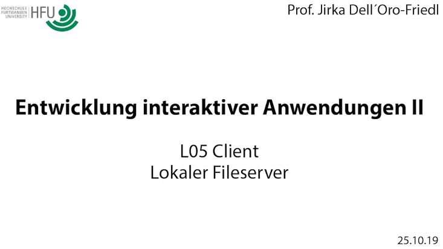
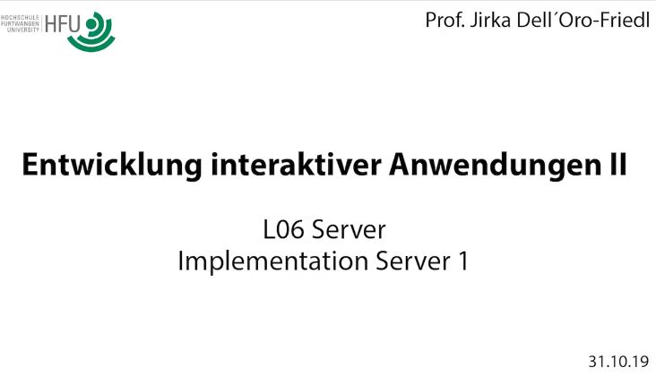
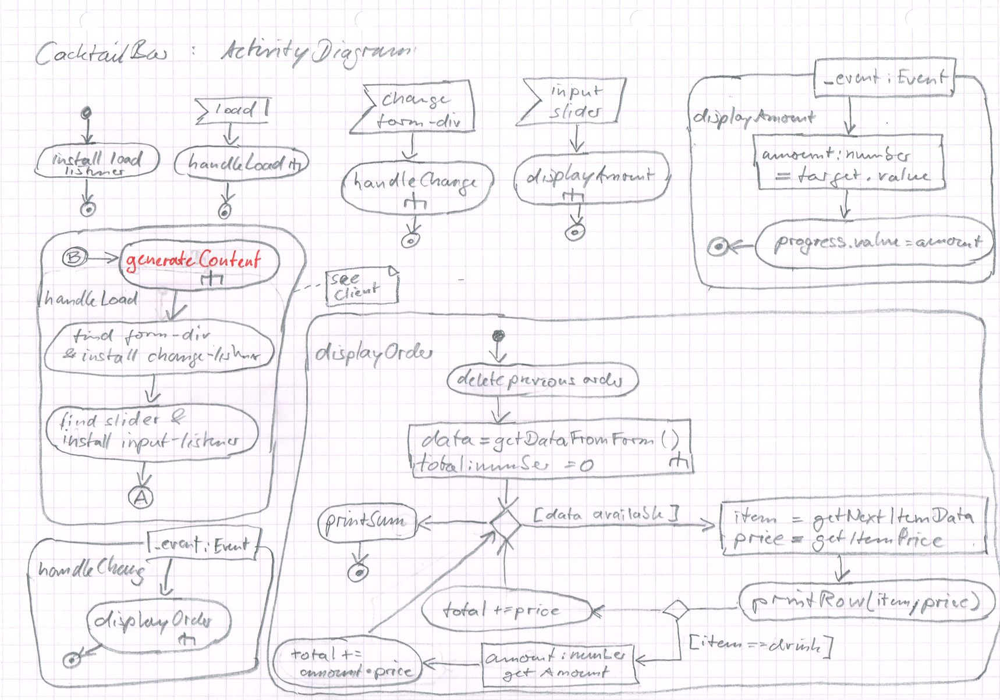
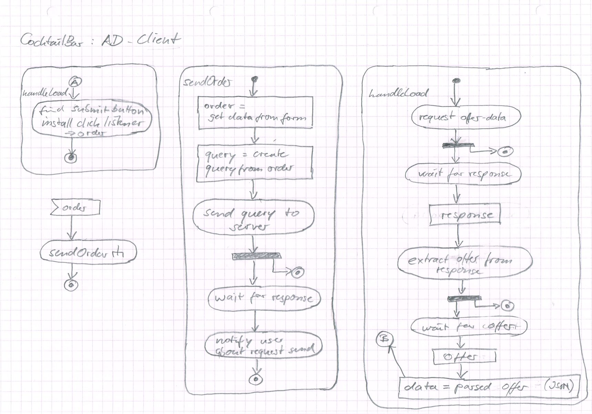

# L05_Client
  
<small>Quelle: <a href="https://arnoldzwicky.org/category/these-modern-times/page/3/">https://arnoldzwicky.org/category/these-modern-times/page/3/</a></small>

The cocktail bar already works quite well as it is, but there is still one major drawback: the order is not yet being sent. As long as the bartender is not sitting next to the customer while they are putting together their cocktail, the business will be lost. However, this situation does not match the use cases we are considering and makes the system obsolete anyway.
Therefore, the web page that is displayed by the customer’s browser on their computer must communicate with another computer that receives the order, processes it, and finally communicates it to the bartender. If necessary, it should also provide feedback about the processing, which in turn is received by the customer’s browser and displayed to them.

- [x] Read this short [Wikipedia-Artikel](https://de.wikipedia.org/wiki/Client-Server-Modell) to clarify some basic terms of the client–server model.

## Use Case Diagram
In fact, the cocktail bar already uses a client–server system as soon as it is published on GitHub Pages. Pages acts as a file server and delivers the HTML, CSS, and JS files that a browser can interpret. The browser acts as the client, and it does not matter on which computer it runs, as long as it can communicate with the server via an internet connection.
- [x] Compare this with the [EIA2-Landschaft](../X01_Appendix/Landscape/EIA2Landscape2022.svg). Which systems and processes are you already familiar with from EIA1 and EIA2? Draw a closed polyline that includes all of these and excludes all unknown processes and systems.

If we split the use case diagram so that it shows two systems, client and server, it becomes clear that
- the customer interacts with a different system than the bartender
- the order has to be transferred from one system, the client, to the other system, the server.  

  
> The file serving mentioned above is not shown here, since the browser and server already take care of this automatically.

## Communication
Communication is the process of exchanging or transferring information. There are two basic forms of communication that are distinguished. 
### Synchronous
  

Synchronous means “at the same time”. In communication, however, this does not mean “simultaneous”, but “coordinated in time”. This means that the communication partners wait for each other until the other has transferred their information and then begin transferring in turn. Thus, the systems involved inevitably spend half of the time available waiting. In the diagram that shows the communication algorithm of one of the partners, this is indicated by the small loop.

- [x] Collect examples of synchronous communication in your own everyday life.

As small as this loop may seem, it can be a big problem. The systems could make sensible use of the waiting time instead of just staying in it. It becomes particularly problematic when a system needs a long time to respond. For example, if a website no longer reacts because the browser is waiting for an answer from the server, the user will soon abort the process.


### Asynchronous 
  
For this reason, asynchronous communication has become established. The communication partners send one or more requests; with that their part is initially done and they can take care of other tasks. When an answer to one of the requests is available, the requesting system receives a signal. This serves as the starting point for a new process in which the answer is first processed and, if necessary, further requests are sent.  

- [x] Collect examples of asynchronous communication in your own everyday life.
- [x] What are the particular challenges of asynchronous communication?

This makes it possible for websites, for example, to build up the display and provide interaction while further data are being loaded. Or to send data during interaction with the user.

## Forms
HTML forms already offer the possibility of sending data synchronously completely without additional programming. For this, it is only necessary to add an `action` and a `method` attribute to the form tag and to integrate a submit button in the form. The `action`value specifies the URL to which the data should be sent. The data themselves, i.e. the values of the form elements, are automatically prepared and sent when the submit button is pressed. How they are sent depends on the chosen `method`.
### Get
With `method="get"`, the data are simply appended to the URL in plain text as strings, separated by a `?`. The key–value pairs are separated from each other by `&` (et, ampersand), the keys and values are connected by `=`. The browser then calls this URL including the appendix, the complete string appears in the address bar.

- [x] Surf the web and look for examples of data transfer in this form by observing the address bar.
- [x] Extend the form element of your current cocktail bar implementation with the attributes `method="get"` and `action=""`. The empty value for `action` means that the current URL is to be used again. Additionally, insert a submit button in the form with
```html
<button type="submit">Submit</button>
```
, examine what happens when you now call the page and press the button.
> The type `"submit"` is the default for buttons and does not have to be specified explicitly. So every button inside a form for which no other type is explicitly specified will trigger sending the data. And this frequently leads to confusion among developers...

### Post
With `method="post"` werden die Daten als eigene Datenpakete versand und sind nicht für das Nutzeri sichtbar. Post wird aber vor allem auch dann verwendet, wenn größere Datenmengen verschickt werden, da die zulässige Länge des URL begrenzt ist. Auf der Serverseite müssen die Datenpakete zunächst erst wieder zu einer zusammenhängenden Request zusammengefügt werden.
- [x] Verwende nun die Methode `"post"` im Formular und betätige den Submit-Button. Versuche nun mit Hilfe der Entwicklertools die Daten zu finden. Klicke dazu auf den Reiter "Netzwerk" oder "Netzwerkanalyse" und dann auf den Post-Request bei den gelisteten Anfragen.  

## Implementation asynchroner Kommunikation
#### XmlHttpRequest-Events
Bei der asynchronen Kommunikation lässt sich wieder sehr gut die nun wohlbekannte Ereignissteuerung einsetzen. JavaScript bietet hierzu das Standardobjekt `XMLHttpRequest` an. Ein solches Objekt kann mit dem Schlüsselwort `new` erzeugt werden. Das Objekt bietet einige Kommandos, mit denen recht einfach eine Verbindung zum Server aufgebaut und eine Request verschickt werden kann. Während das Objekt die Verbindung verwaltet, erzeugt es bei Statusänderungen entsprechende Events, die wiederum mit dem üblichen Schema von Listeners abgefangen und an die zugehörigen Handlerfunktionen weitergeleitet werden. Auch die vollständige Übertragung der Serverantwort ist eine solche Statusänderung, womit das oben dargestellte Schema der asynchronen Kommunikation clientseitig implementiert werden kann.  
> Das XML im Namen des Objektes verrät, dass es sich dabei um eine etwas betagte Technologie handelt, die 1999, während der Standardisierung von HTML4, von Microsoft veröffentlicht wurde. Sie ist aber verbreitet und kommt noch häufig zum Einsatz. [Mehr Infos gibt es hier.](https://wiki.selfhtml.org/wiki/JavaScript/XMLHttpRequest)

#### Fetch & Promises
2017 wurde die globale JavaScript-Funktion `fetch` als Schnittstelle für asynchrone Kommunikation eingeführt. So kann mit einer einzigen Anweisung nach dem Muster `fetch(url [, data])` eine Request verschickt und eine Response erhalten werden. Aufgrund der Asynchronität liefert fetch aber nicht sofort die Antwort des Servers, sondern ein Objekt vom Typ `Promise`. Dies kann metaphorisch betrachtet werden: Das Versprechen, das fetch abgibt, verpflichtet dazu, die eigentliche Funktion auszuführen, in diesem Falle also zu kommunizieren, und im Erfolgsfall, sowie im Falle des Misserfolgs, bestimmte weitere Funktionen aufzurufen. Es handelt sich also wieder um eine Ereignissteuerung, die aber in einem etwas anderen Gewand daherkommt.  

Im einfachsten Fall sieht das ganze Konstrukt dann so aus:
```typescript
    function communicate(_url: RequestInfo): void {
        // try to communicate
        let promise: Promise<Response> = fetch(_url);
        // establish the functions to call when communication 1. succeeds, 2. fails
        promise.then(handleSuccess, handleFailure);
    }

    function handleFailure(_response: Response): void {
        console.log("Failure", _response);
    }

    function handleSuccess(_response: Response): void {
        console.log("Success", _response);
    }
```
Auch hier ist die Funktionalität über mehrere Funktionen verteilt und daher insgesamt unübersichtlich. Das wird noch verstärkt dadurch, dass die Response, die den Handlern von der Promise als Parameter übergeben wird, noch nicht die Rohdaten der Antwort des Kommunikationspartners darstellt. Um die Response zu verarbeiten sind weitere Funktionen erforderlich, die wiederum Promises erzeugen, die weitere Handler aufrufen und so weiter. 
> **FunFact:** Dadurch entsteht ein Gewirr an Funktionen, das von Entwickleris als "Callback Hell" bezeichnet wird.

#### Async/Await
Deswegen wurden 2017 auch die neuen Schlüsselworte `async` und `await` in JavaScript implementiert. Damit wird nun etwas ganz Erstaunliches möglich. Anstatt mit der synchronen Programmierweise (eine Anweisung im Code erfolgt strikt nach Beendigung der vorangegangenen) und Events asynchrone Prozesse abzubilden und damit "Callback Hell" zu erzeugen, wird mit Hilfe der beiden Schlüsselworte die Programmierung selbst asynchron. Damit wird das fetch-Beispiel plötzlich extrem übersichtlich:

```typescript
    async function communicate(_url: RequestInfo): Promise<void> {
        let response: Response = await fetch(_url);
        console.log("Response", response);
    }
```
Mit dem Schlüsselwort `async` wird eine Funktion als asynchron deklariert, das bedeutet, dass ihre Ausführung unterbrochen und zu einem späteren Zeitpunkt fortgesetzt werden kann. Genau dies bewirkt das Schlüsselwort `await`, welches daher nur innerhalb von asynchronen Funktionen Sinn ergibt. Sobald `fetch` gestartet wird, wird die Funktion `communicate` zunächst beendet und die Ausführung des Programms bei der nächsten Anweisung nach deren Aufruf fortgesetzt. Sobald aber `fetch` beendet wurde, wird die Funktion `communicate` bei der Anweisung nach dem fetch fortgesetzt. Das heißt also, dass das Hauptprogramm, sofern es noch nicht komplett abgelaufen ist, unterbrochen wird um die Ausgabe der Response in der Konsole zu bewerkstelligen. Danach ist `communicate` tatsächlich am Ende und das Hauptprogramm wird fortgesetzt. Es könnten aber in der Funktion noch weitere `await`s folgen, die wieder entsprechendes Verhalten bewirken. So bläht die weitere Verarbeitung der Response den Code nicht doch wieder durch Callbacks auf.  
- [x] Kopiere obenstehenden asynchronen Code und bette ihn in ein neues Programm ein. Lasse vom Hauptprogramm aus die Funktion `communicate` mit dem Parameter "https://jirkadelloro.github.io/Code-Inverted/L05_Client/Material/Test.txt" aufrufen. Lasse vor und nach dem Aufruf von `communicate` in der Konsole die Zeichenketten "Start" und "End" ausgeben.
- [x] Starte nun das Programm, nachdem Du es lauffähig implementiert hast. Beschreibe deine Beobachtung. In welcher Reihenfolge kommen die Ausgabe in der Konsole?
- [x] Das ausgegebene Response-Objekt ist komplex und der eigentliche Inhalt der Serverantwort ist noch nicht zu sehen. Erweitere die Funktion `communicate` um eine Zeile, in der Du die Methode text() des Response-Objektes aufrufst. Achtung: text() gibt wieder eine Promise zurück. Nutzt Du aber auch hier `await` erhältst Du als Ergebnis des Ganzen eine Zeichenkette, die Du einer Variablen vom Typ string zuweist. Lasse so den Inhalt der Serverantwort ausgeben.  

## Uniform Resource Locator (URL)
Jetzt hast Du einige Werkzeuge an der Hand um synchrone oder asynchrone Kommunikation von der Clientseite aus zu starten, also eine Request zu verschicken und eine Response vom Server zu erhalten. Derzeit wird nur die Get-Methode betrachtet, bei der die Nutzdaten in den URL-String eingebettet werden. Bei der asynchronen Kommunikation muss dies nun noch getan werden. Dazu sollte zunächst der Aufbau des URL näher untersucht werden.
- [x] Studiere den Aufbau des URL anhand der folgenden Grafik.  
  
<small>Quelle: <a href="https://nodejs.org/dist/latest-v12.x/docs/api/url.html#url_url_strings_and_url_objects">https://nodejs.org/dist/latest-v12.x/docs/api/url.html#url_url_strings_and_url_objects</a></small>  

### Teil 1
Protocol, Authentifizierung und Host werden benötigt, um eine Verbindung zu einem Server aufzubauen. Häufig genügt allerdings bereits die Angabe des Hostnamen, z.B. www.hs-furtwangen.de, um Browser und Server zur Kommunikation zu bewegen.  
> So ausgeschrieben ist die Darstellung der Hostnamen eine Hilfestellung für Menschen. Tatsächlich baut der Browser zunächst eine Verbindung zu einem Name-Server auf und fragt dort nach der unter diesem Namen hinterlegten Adresse.  
- [x] Gib in der Adresszeile des Browsers eine "echte" Adresse ein: 141.28.2.12

### Teil 2
Der zweite Teil des URL wird dann von dem erreichten Server beliebig interpretiert. Ein reiner File-Server versucht im Pfadnamen eine Ordnerstruktur zu erkennen um in seinem Speichersystem eine Datei zu finden, deren Inhalt er als Antwort zurückliefert. github.io ist so ein reiner Fileserver, er hat in obigen Beispiel einfach den Inhalt der Datei Test.txt zurückgeliefert.

#### Query-String
Der Query-String stellt nun die eigentlichen Nutzdaten dar, die bei der synchronen Übertragung mit der Get-Methode des Formulars bereits automatisch aufbereitet und mitgeschickt wurden. Ein Application-Server, der bezüglich Funktionalität über die Möglichkeiten eines reinen Fileservers hinausgeht, kann diesen String interpretieren und mit den gewonnenen Daten Berechnungen anstellen oder weitere Prozesse steuern.

## Daten asynchron senden
Um also Daten per Get mit Fetch zu senden, muss lediglich der URL um den Query-String erweitert werden. Wie dieser String zustande kommt ist irrelevant, hier kann man beliebig kreativ werden. Sofern die Daten aus einem Formular aber bereits vorliegen, ist es einfach möglich, ihn aus einem FormData-Objekt zu generieren. Hierbei hilft ein weiteres Standard-JavaScript-Objekt: URLSearchParams
```typescript
let url: string = "https://whatever.server/path/file";
let query: URLSearchParams = new URLSearchParams(<any>formData);
url += url + "?" + query.toString();
await fetch(url);
```
> Zur Zeit (2019) wird leider noch ein kleiner Hack verwendet, da TypeScript noch nicht ein Objekt vom Typ FormData als Parameter akzeptiert und daher mit `<any>` ausgetrickst werden muss.

### Custom Data
Ein Objekt vom Typ `URLSearchParams` lässt sich fast genauso verwenden wie eines vom Typ `FormData`. Insbesondere können an beide Objekte per `append` noch weitere Schlüssel-Werte-Paare angefügt werden. So ist es sehr leicht auch Informationen, die nicht aus einem Formular kommen, mit auf den Weg zu schicken.  

> **Zusatzinfo**: `fetch` akzeptiert neben dem URL noch einen zweiten Parameter, ein `RequestInit`-Objekt. Damit lassen sich noch viele weitere zusätzliche Steuerinformationen für die Kommunikation angeben und auch sehr einfach die Post-Methode für die Datenübertragung verwenden. Auch kann dabei das FormData-Objekt direkt genutzt werden. 

# Cocktailbar: Bestellung versenden

<div align="center">
<a href="http://hdl.handle.net/10900.3/OER_DLGSHALR"></a>
<a href="Material/CocktailBar_UI-Scribble.jpg"></a>
  <br/>
<a href="http://hdl.handle.net/10900.3/OER_DLGSHALR"> L05 Client: Aktivitätsdiagramm</a>
</div>


## Implementation I
<div align="center">
<a href="http://hdl.handle.net/10900.3/OER_ZMJSQDTS"></a>
  <br/>
<a href="http://hdl.handle.net/10900.3/OER_ZMJSQDTS"> L05 Client: Implementation I</a>
</div>

- [x] Ergänze die Implementation so, dass beim Reset die Bestellübersicht gelöscht wird!

## Weitere Infos

<details>
<summary>Lokaler Fileserver</summary>
Das VSCode-Plugin LiveServer kennst Du bereits und nutzt es wahrscheinlich. Damit ist das CORS-Problem bereits umgangen. Es gibt noch weitere Möglichkeiten, einen lokalen Server zu betreiben.  
Beim Testen auf der lokalen Maschine tritt nun ein Fehler auf. Der URL wird als ungültig erkannt, da nicht das HyperText-Transfer-Protocol genutzt wird. Es greifen Sicherheitsmechanismen des Browsers, die verhindern, dass Skripte von Websiten auf die lokalen Speichermedien des Clientrechners zugreifen. Sie gehören zur Cross-Origin-Resource-Sharing-Policy (CORS) die regelt, welche Ressourcen von welcher Quelle auf welche Ressourcen von welcher anderen Quelle zugreifen dürfen.  
Sobald die Cocktailbar von Github-Pages aus aufgerufen wird, tritt das Problem nicht auf. Alle Resourcen befinden sich in derselben Domäne im Netz, wo mit dem http-Protocol gearbeitet wird, und der Zugriff mit `fetch` ist erlaubt.  
Es wäre natürlich sehr lästig, während der Entwicklung für jeden Test zunächst das aktuelle Projekt auf einen entfernten Fileserver kopieren zu müssen. Stattdessen ist es einfach möglich, die lokale Entwicklungsmaschine zu einem Fileserver zu machen und das Projekt dann unter "Internetbedingungen" zu testen. Im folgenden Beispiel wird hierzu ein winziger Fileserver genutzt, der unter <https://www.npmjs.com/package/serve> zu finden ist.

<div align="center">
<a href="http://hdl.handle.net/10900.3/OER_ECPNTLWE"></a>
  <br/>
<a href="http://hdl.handle.net/10900.3/OER_ECPNTLWE"> L05 Client: Lokaler Fileserver</a>
</div>
</details>

<details>
<summary>Submit-Button</summary>  

Es gibt verschiedene Möglichkeiten, das Problem des Submitbuttons zu lösen.  
<ul>
  <li>im Skript mit `_event.preventDefault()` das Standardverhalten unterbinden</li>
  <li>als Typ des Buttons in der HTML-Datei `"button"` definieren</li>
  <li>den Button außerhalb des Formulars platzieren</li>  
</ul>
</details>

## Daten nachladen
`fetch` und die Erkenntnisse aus diesem Kapitel können auch genutzt werden, um das Problem zu lösen, das im vorangegangenen Kapitel noch übrig blieb: die Daten zum Angebot des Barkeeperis vollständig aus dem Programmcode herauszulösen. Ein Fileserver kann, so wie es zuvor mit der Datei Test.txt geschehen ist, den Inhalt einer Datei als Zeichenkette liefern, der Client kann diese Antwort weiterverarbeiten.  
Im letzten Kapitel wurde die Variable `data` direkt im Code definiert, die Daten waren im Code literal gegeben. Dadurch war es leicht möglich, mit der Punkt-Syntax oder der Klammer-Syntax auf die Daten zuzugreifen und deren hierarchische Ordnung zu nutzen. Liegt nun die Information lediglich als Zeichenkette in der Response vor, ist es wünschenswert, diese ebenso in ein assoziatives Array umzuwandeln.

### JSON-Objekt
Hierfür stellt JavaScript das JSON-Objekt zur Verfügung, mit dem die Erzeugung eines assoziativen Arrays auf Basis der in einer Zeichenkette enthaltenen Information leicht möglich ist. Ebenso kann damit umgekehrt die Repräsentation eines solchen Arrays in Form einer Zeichenkette erzeugt werden. Das JSON-Objekt stellt hierfür zwei Methoden zur Verfügung: `parse` und `stringify`.

<div align="center">
<a href="http://hdl.handle.net/10900.3/OER_CRBMCJPT"></a>
<a href="Material/CocktailBar_ActivityDiagram.jpg"></a>
<a href="Material/CocktailBar_ActivityDiagram_Client.jpg"></a>
  <br/>
<a href="http://hdl.handle.net/10900.3/OER_CRBMCJPT"> L05 Client: Diagramme</a>
</div>

> **Hinweis:** Im Video wird der Begriff "Marker" verwendet, die korrekte Bezeichnung laut UML-Standard ist "Konnektor"

## Implementation II

<div align="center">
<a href="http://hdl.handle.net/10900.3/OER_IBOVUHND"></a>
<br/>
<a href="http://hdl.handle.net/10900.3/OER_IBOVUHND"> L05 Client: Implementation II</a>
</div>

> **Hinweis:** Es existiert bereits eine Fülle von kostenlosen JSON-Editoren, die man dem Barkeeper an die Hand geben könnte, um möglichst fehlerfrei das Angebot zu editieren.
