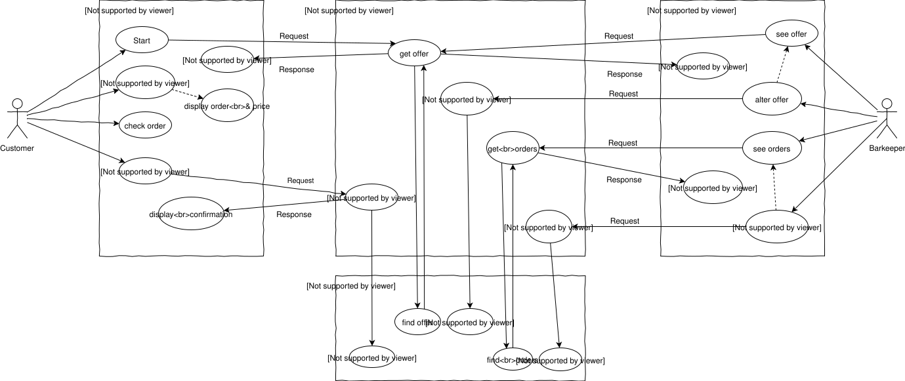
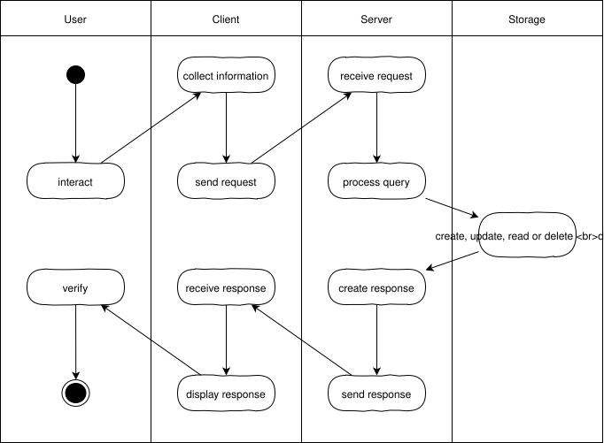

# L06_DatabaseServer

<small>Quelle: <a href="https://xkcd.com/910/">https://xkcd.com/910/</a></small>  

A standard file server naturally fails to meet the requirements the cocktail bar places on the receiving end of the communication. While the order does arrive, the server software is not programmed to process it; the query string is simply ignored. However, exactly what is supposed to happen with it has not yet been defined; the previous chapter merely established that the server should accept the order.

We must now assume that the bartender isn't sitting in a data center basement, waiting for a window to pop up on a monitor displaying an order. Unlike at a physical bar, the bartender and the customer now communicate asynchronously. Consequently, orders must be stored in such a way that the bartender can access them at any time from other clients. This means we need a data store as an additional system component.

## Use-Case-Diagram



In addition to the data store, a client for the bartender role was also included in the diagram. It is at this point that the usefulness of use case diagrams in the early stages of software development becomes clear.

> - [x] Study the diagram shown closely and explain what it represents.

## Swimlane-Activity Diagram
A pattern is evident in the use case diagram. Often, a user interaction triggers an activity in the client, resulting in a request being sent to the server; the server then accesses the data store, formulates a response, and sends it back to the client, which processes it and provides feedback to the user. This standard activity spanning system boundaries can also be represented in an activity diagram.

  

Each participating system and, where applicable, the user is represented in its own area, known as a "swimlane."

## database
What was initially referred to above in general terms as data storage is typically database software capable of managing large volumes of data quickly and efficiently. These systems are generally standardized, meaning that server software does not need to deal with their internal workings but simply needs to use the correct commands and data formats to interact with the database.

### Relational databases
Since the 1970s, relational databases—in which data is organized into table structures and cross-references create a network of tables—have dominated the field. Structured Query Language (SQL) was developed as a query language for formulating complex instructions that the database software then executes autonomously to retrieve or manipulate data. Today, the open-source database software MySQL, in particular, is widely used across the Internet.
> **FunFact:** People often intuitively interpret the name "MySQL" as meaning "My SQL." In reality, however, the Finnish developer Michael Widenius named the open-source project he launched in 1994 after his daughter, My.

### NoSQL-Data bases
With the steadily increasing volume of data driven by the Internet, the need for scalability options grew ever greater. Ideally, a database's performance and capacity should be easily increased during operation by adding more hardware. However, relational database systems were not originally designed to distribute data.
NoSQL—or document-oriented—databases address this issue. The data to be managed does not need to be forced into a rigidly defined tabular format; instead, each record can be stored as a document with an arbitrary structure.
The "No" in NoSQL stands for "Not only," meaning there are also systems capable of working with SQL. Document-oriented databases are one type of NoSQL database; others exist as well.

### MongoDB
In 2009, MongoDB was released—a NoSQL database software that uses JavaScript as its internal lingua franca. Data is stored in JSON format, and queries and aggregation functions can be formulated directly as JavaScript statements; furthermore, entire sequences of statements can be sent to the database system and executed there.

> **FunFact:** The name MongoDB is derived from *humongous*, referring to the enormous volume of data that can be managed with this software.

Combined with Node.js—which enables the use of JavaScript outside the browser—the entire server-side component can now be implemented using JavaScript or TypeScript. Deno, the successor project to Node.js, supports TypeScript natively. Although current web installations are still dominated by JavaScript, PHP, and MySQL, using Node.js, TypeScript, and MongoDB positions you well for the future.

For the conceptual design, however, it is initially immaterial which systems are ultimately used.

## MingiDB
Installing and setting up a network-based database and developing the server-side control software would go beyond the scope of this course. Consequently, a lightweight server application was developed specifically for this purpose; modeled on MongoDB, it is extremely easy to install and allows direct insight into the managed data, yet it lacks any security mechanisms or optimizations.

> **Attention:** MingiDB was developed exclusively for educational purposes and prototypes and must not be used for any other purpose.

### database
A MingiDB database is simply a folder on an internet-accessible computer capable of processing PHP, containing the MingiDB `index.php` file. The PHP script within this folder automatically creates JSON files—referred to as `collections` inside the folder itself. The individual entries within a `collection` are called `documents` and are essentially the familiar associative arrays in JSON format. MingiDB automatically assigns a unique identifier to each entry, even if the contents are otherwise identical.

```plaintext
Database
├ Collection_0
├ Collection_1
│ ├ Document_0
│ ├ Document_1
│ ├ Document_2
│ └ ...
├ Collection_2
└ ...  
```  

### Server
The script also serves as the server with which the client communicates. Typically, such a server can be freely programmed and can independently generate, modify, and validate data. For this course, however, it suffices for the server to interpret the queries received from the client according to a predefined scheme and manage the data accordingly.

### Installation
GitHub Pages is strictly a file server, so you have no way to implement additional server-side functionality. Your database must be hosted by a service that supports this capability, and you need unrestricted access to it. Instead, use your own HFU webspace, where custom programs can be executed on the server side. You can manage these and other files there yourself using the File Transfer Protocol (FTP or SFTP)—much like working with your local file system.
- [x] First, familiarize yourself with the web space provided by the university and with one of the recommended FTP clients. See <https://howto.hs-furtwangen.de/webdata/>
- [x] Get MingiDB now from <https://github.com/JirkaDellOro/MingiDB> and follow the installation instructions and the tutorial. 
- [x] Experiment with the MingiDB client and your database.

# Cocktail bar: Database connectivity
MingiDB can thus accept GET requests from the client, interpret the query, and manage the data store—creating, reading, updating, and deleting data records within it. These four activities are fundamental and are briefly summarized by the acronym `CRUD`.

Like MongoDB, MingiDB expects data in JSON format. Additionally, the query requires a command and the specification of the collection. This means it must be processed before being sent.

## Converting
Unfortunately, neither FormData nor URLSearchParams offers methods for converting form data into the required JSON format. However, the algorithm for doing so is not particularly complex.
```typescript 
interface FormDataJSON {
  [key: string]: FormDataEntryValue | FormDataEntryValue[];
}

let formData: FormData = new FormData(form);
let json: FormDataJSON = {};

for (let key of formData.keys())
  if (!json[key]) {
    let values: FormDataEntryValue[] = formData.getAll(key);
    json[key] = values.length > 1 ? values : values[0];
  }
```
- [x] Find out what is happening here. Research the types and instructions online.

## Query
Initially, the focus is solely on the order, so only the "insert" command is required. The collection is named "Orders," and it is assumed that it already exists in the database. The query can now be easily created using an empty URLSearchParams object.
```typescript
let query: URLSearchParams = new URLSearchParams();
query.set("command", "insert");
query.set("collection", "Orders");
query.set("data", JSON.stringify(json));
```
A query generated in this way now looks like this, for example, in its string representation:  
`?command=insert&collection=Orders&data={"Drink":"Sex on the beach","Container":"Papercup","Extras":["Lemon","Orange"],"Amount":"0.4"}`

- [x] Copy the code into the `sendOrder` function of your cocktail bar (or get the code from the attachment) and get it working with your own database. To do this, you must first create an "Orders" collection and specify the URL for your database in the code.

## Offer
The Barkeeper offering is currently stored as a static file within the application. According to the use-case diagram, it should reside in an `offer` collection. While it would be possible to store the entire offering as a single document—just as it is currently set up—database functionality might be better utilized by splitting the offering across multiple documents. These could look like this:
```typescript
{ Drink: [ { name: "Mojito", price: 25.00 }, { name: "Caipirinha", price: 30.00 }, ... ] }
{ Extras: [ { name: "Ice", price: 0.50 }, { name: "Lemon", price: 0.20}, ... ]}
...
```
It is also possible—and perhaps sensible—to create dedicated collections for drinks, extras, containers, etc., with a separate document for each item within them.
```typescript
Collection Drink
{ name: "Mojito", price: 25.00 }
{ name: "Caipirinha", price: 30.00 }
...
Collection Extras
{ name: "Ice", price: 0.50 }
{ name: "Lemon", price: 0.20}
...
```
You could also create these collections in a separate database—or, in the case of MingiDB, a separate folder—for the Barkeeperi offering, thereby keeping them more strictly separated from the orders.  

>**Attention:** So, how information should be structured in databases is a design decision you have to make!

